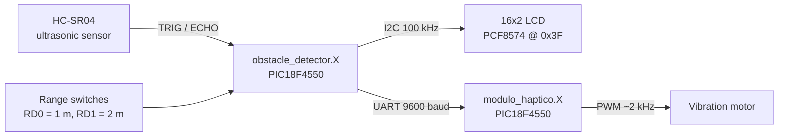

# Obstacle detector with haptic feedback (PIC18F4550)

Graduation project of a diploma program (2024). Two PIC18F4550 boards work together: the first one measures the distance to an obstacle with an ultrasonic sensor and shows it on an I2C LCD; the second one receives that distance over UART and drives a vibration motor that gets stronger as the obstacle gets closer.

All peripheral drivers are register-level C, without MCC or Microchip peripheral libraries: I2C master, HD44780 LCD over a PCF8574 I/O expander, HC-SR04 ultrasonic sensor, USART and PWM.

## obstacle_detector.X

| Function | Implementation |
|----------|----------------|
| Distance measurement | 10 µs trigger pulse on RA0; Timer0 (16-bit, Fosc/4 = 2 MHz, 0.5 µs per tick) measures the echo pulse on RA1. Distance [cm] = ticks × 0.0085, averaged over 5 measurements. |
| Range selection | Switches on PORTD select the 1 m or 2 m detection range. |
| I2C master | MSSP module in master mode at 100 kHz (`SSPADD = Fosc / (4 × f_SCL) − 1`), with start, repeated start, stop, write and read with ACK/NACK. |
| LCD driver | HD44780 in 4-bit mode through a PCF8574 expander (P0 = RS, P1 = RW, P2 = E, P3 = backlight, P4–P7 = D4–D7): power-on initialization sequence, commands, text at any row and column. |
| UART | 9600 baud with the 16-bit baud rate generator; sends the mode and the distance to the haptic module. |

## modulo_haptico.X

| Function | Implementation |
|----------|----------------|
| UART receive | Waits for the mode command, then reads one distance per line and converts it with `atoi()`. |
| Distance to intensity | Inverse linear mapping: distance 0 → maximum duty cycle, distance at the range limit → 0. |
| PWM | CCP1 on RC2 in PWM mode, Timer2 with prescaler 16 and PR2 = 62: about 2 kHz at 8 MHz. |

## UART protocol (9600 baud, 8N1)

| Message | Sent when | Haptic module action |
|---------|-----------|----------------------|
| `a` | 1 m range selected | Range limit = 100 cm |
| `b` | 2 m range selected | Range limit = 200 cm |
| `<distance>\r\n` | Every ~200 ms while a range is active | Sets the vibration intensity |
| `100` / `200` | Obstacle beyond the range | Motor off (zero intensity) |
| `0` | No range selected | Stops the motor and waits for a new mode |

## Pinout

| Board | Pin | Signal |
|-------|-----|--------|
| Detector | RA0 / RA1 | HC-SR04 TRIG / ECHO |
| Detector | RB0 / RB1 | I2C SDA / SCL |
| Detector | RC6 / RC7 | UART TX / RX |
| Detector | RD0 / RD1 | Range switches (1 m / 2 m) |
| Haptic | RC7 / RC6 | UART RX / TX |
| Haptic | RC2 | PWM (CCP1) to the motor driver |
| Haptic | PORTB | Last received value (debug LEDs) |

Both boards run from the internal oscillator at 8 MHz.

## Build

Open each `.X` folder in MPLAB X IDE and build with the XC8 compiler (v3.00). Target device: PIC18F4550.

## Possible improvements

- Add a timeout to the echo measurement so the firmware cannot hang if the sensor is disconnected.
- Replace the floating-point distance math with integer arithmetic, which is much cheaper on an 8-bit core.
- Receive UART data with interrupts and a ring buffer instead of polling.
